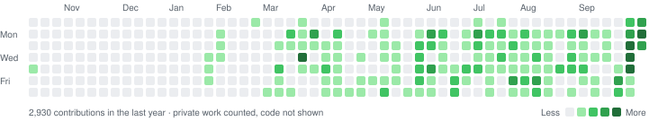
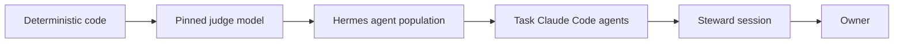

<h1 align="center">Mohammed Elsiddig</h1>

<b>AI Lead / AI Architect</b> · agentic systems in production · robotic intelligence · Dubai

I build agent systems that survive contact with real users: the model sits inside a deterministic core, every change is gated by tests and budgets, and every claim the system makes about itself is checked. I lead AI at **Debot Intelligent Automation**, Royal Furniture Group's AI and robotics venture, where I took the group's first production agentic-operations system from prototype to 1,400+ staff. My code is private (employer and client work); this page shows what each system is and how it is built.

<picture>
  <source media="(prefers-color-scheme: dark)" srcset="assets/contrib-dark.svg">
  
</picture>

<!-- TRACK:START -->
**25 repositories** · 23 owned · 2 contributed to · all private · active since 2021 · last push 2026-10 
By language: `Python` 10 · `Jupyter Notebook` 7 · `TypeScript` 3 · `JavaScript` 2 · `Shell` 1 · `Vue` 1

<b>16 named projects</b> · 9 more counted, not named

| Project | What it is | Stack | Period |
|---|---|---|---|
| **Video Engagement Model** 🔒 | Multimodal engagement predictor: SigLIP2 frame embeddings through a DeiT encoder, fused with text | PyTorch · Keras · Transformers | 2025-04 → 2026-10 |
| **Lernactal-OS** 🔒 | Self-improving personal AI operating system: a ranked population of agents under measured, adversarially reviewed change | Python · Hermes Agent · Claude Code · Docker | 2026-09 → 2026-10 |
| **Royal AI Assistant** 🔒 | Production WhatsApp agentic-operations system for a 1,400-staff UAE retail group | TypeScript · PostgreSQL · AWS · OpenClaw | 2026-03 → 2026-09 |
| **Robotics AI Bench** 🔒 | Phase-0 perception bench for an industrial arm: GPU pose workers over ZeroMQ, telemetry, AI kept advisory | Python · Docker · YOLO11 · MediaPipe | 2026-04 |
| **Stock-Health Agent** 🔒 | Inventory advisor: LLM drives a deterministic stock engine and a bounded research sub-agent inside an egress-locked runtime | TypeScript · OpenClaw · AWS CDK | 2026-04 |
| **LLM Robot Cell** 🔒 | ROS2 cell where LLM motion plans pass a deterministic safety gate; rejections feed back into replanning | Python · ROS2 · FastAPI | 2026-02 |
| **Budget Analyst Agent** 🔒 | Text-to-SQL analyst: token-budgeted schema loading, read-only SQL validation, DSPy-compiled modules, calibrated confidence | Python · LangGraph · DSPy · MCP | 2026-01 → 2026-02 |
| **Budget Analyst UI** 🔒 | Streaming chat front end for the budget analyst: tool-call events over the Vercel AI SDK | TypeScript · Next.js · AI SDK | 2026-02 |
| **Growbal AI Core** 🔒 | Agentic crawler, hybrid vector search and onboarding research agent for a B2B services marketplace | Python · Django · LangGraph · pgvector | 2025-06 → 2025-10 |
| **Hybrid RAG + SQL Agent** 🔒 | Routes questions to documents, SQL or both on a local 3.8B model, with typed repair loops and citations | Python · LangGraph · DSPy · Ollama | 2025-09 |
| **Research Digest Agent** 🔒 | Scheduled search → relevance filter → summariser–reviewer critique loop → daily e-mail digest | Python · LangGraph | 2025-03 |
| **Speaking Coach** 🔒 | Local reasoning-model coach with a staged assessment dialogue and an embedding-quantised response cache | Python · Ollama · Gradio | 2025-03 |
| **BirdCLEF 2024** 🔒 | Audio frames (MFCC + RMS) reshaped by convolution into a pretrained ViT's input space | TensorFlow · Keras | 2024-06 |
| **Harmful Algae Detection** 🔒 | CNN proof of concept on underwater microscopy for a harmful-algal-bloom early-warning system | TensorFlow · DVC | 2024-01 |
| **Logo Standardizer** 🔒 | OpenCV pipeline that finds a logo and its background and normalises crop, centring and mask | Python · OpenCV | 2023-04 |
| **Graph Traffic Forecast** 🔒 | GCN-LSTM spatio-temporal forecasting on a road-sensor graph (MASE 0.69 vs naive) | TensorFlow · StellarGraph | 2021-10 |

🔒 private: name, description and dates shown; code is not. The 9 unnamed repositories are client work, research notebooks and experiments. Generated from repository metadata by <code>scripts/track-record.sh</code>.

<!-- TRACK:END -->

## Flagships

### 🐉 Lernactal-OS · a personal AI operating system that evolves by adversarial iteration
`2026 – now` · `Python` `Hermes Agent` `Claude Code` `Docker` · solo · ~790 commits in five weeks, 12 services, 82 decision records

*Lernaean hydra* + *fractal*: every claim is a head, an adversary attacks it, a severed claim grows at least two successors, and the loop runs at every scale. A ranked population of Hermes and headless Claude Code agents on one machine, behind one Telegram chat, does real work: opportunity triage, a curated news desk, a Bayesian forecasting ledger.

<b>Design notes</b>: ranks, measured variants, a frugal read path, code-computed odds

- **Ranks, not managers.** Each rank tunes the one below through *recorded variants* (model × effort × context), each with a measure and a kill rule; peers are equal within a rank, and no agent can edit its own prompt, model or metric.
- **Escalation ladder.** Every "look again later" job climbs code → judge model → agent → frontier agent → human; context shrinks going down, briefs sharpen going up, and each rank audits a sample of the one below.
- **Frugal read path.** A hook refuses whole-file reads of large files and routes them to a cheap judge or a question-focused reader that returns verbatim, line-referenced quotes; a summary is never evidence for a patch.
- **Probabilities come from code.** A model only grades one evidence item against one statement on a capped scale; forecasts are registered before the outcome and scored after, in an append-only ledger.
- **Protected boundaries.** No candidate touches evaluators, sealed tests, the budget ledger or its own approval; only the exact hashed artifact that was evaluated is promoted; images pinned by digest, separate hot and sealed deploy lanes.
- **Budgets and landing.** A content-free usage ledger reconciled against provider usage; every Claude Code session halts at 95% of its usage window. Each change lands with a live end-to-end test (fault before, gone after) and a fresh reviewer told to refute the diff.

### 🛋️ Royal AI Assistant · production agentic operations on WhatsApp
`2026` · `TypeScript` `PostgreSQL` `AWS CDK` `OpenClaw → Hermes` · AI Lead, architect and main author

The group's first production enterprise agent: one WhatsApp contact for customers and 1,400+ staff in English, Arabic and Hindi, answering from live ERP data and turning every unresolved need into a routed, tracked ticket. A steady 3,500+ chat turns and 350–400 unique users a day.

<b>Design notes</b>: safety in the database, a behaviour battery, a pinned and patched framework

- **Topology.** A webhook gate verifies signatures, de-duplicates and stands the AI down while a human replies on the same number; behind it an agent gateway, a cost-logging LLM proxy with sticky failover, a `LISTEN/NOTIFY` paging and dispatch listener, a PDF sidecar, all in AWS CDK.
- **Safety in the database, not the prompt.** Forced row-level security that fails closed, writes only through definer functions, and a one-way, scoped replica of the on-prem ERP (full load plus change data capture).
- **A behaviour battery gates every change:** 340+ scenarios across 16 behaviour dimensions send real signed webhooks to staging and grade the reply, the SQL it ran and the rows it left; it refuses production three independent ways. Model swaps pass frozen-baseline and verbosity gates whose rubric anchors were mined from customer-rated tickets.
- **Patching a pinned, vendored framework** at exact-match patch points: the build fails if one drifts, and each patch has a kill switch and a boot-log line proving it applied.
- **Containment and operations.** Recipient gates, per-customer rate caps with a runaway latch, per-flow kill switches, egress allowlisting; 300+ additive migrations, SHA-tagged staging → prod, post-mortems turned into regression harnesses, and a ~5× cut in model spend with KV-cache hit rate tracked as a first-class metric.
- **Then a migration onto Hermes** for native skill curation, memory consolidation and a SQLite session store, opening the path to one assistant per staff member, connected as peers.

### 🌐 Growbal AI Core · agentic profiling for a B2B services marketplace
`2025` · `Python` `Django` `LangGraph` `pgvector` `vLLM` · main author (76% of commits)

Crawlers find Gulf company-formation, tax and visa providers and build structured profiles; an agent matches users to them; a research-first onboarding flow asks providers only what it couldn't find. Under $0.10 per profile at 95%+ structured-field coverage.

<b>Design notes</b>: line-indexed HTML slicing, hybrid ranking, research-driven onboarding

- **Line-indexed slicing.** Each line of page markdown is tagged `⟦L000⟧`; a small model returns only line *ranges*, so extraction reads a fraction of the page. Later served from a PEFT-fine-tuned open-weight model on vLLM; empty and malformed slices were studied in hypothesis notebooks and fixed with schema-injected function calling plus a rule-based fallback.
- **Retrieval.** pgvector similarity with a capped tag-match boost; a LangGraph *search → adjudicate → summarise* agent streams into the chat front end.
- **Onboarding research orchestrator.** Researches the provider's industry first, then edits the onboarding checklist, so providers confirm facts instead of typing them.
- **Platform.** Django, FastAPI + Gradio chat with server-side sessions and SSO, AWS, CI/CD across microservices, CloudWatch agent-execution telemetry.

## Also built

- **Stock-Health Agent** · `TypeScript` `AWS CDK`: the LLM only *calls* a deterministic stock engine (aging, velocity, cover, transfer-first balancing) and a bounded research sub-agent; confidence weighted by which data is present; egress-locked runtime.
- **Budget Analyst Agent** · `LangGraph` `DSPy` `MCP`: text-to-SQL that sees a ~300-token schema summary, then loads only the domains it picks; a parser-level read-only validator; DSPy modules compiled on a calibration metric. It flagged its own implausible 96.6% margin.
- **LLM Robot Cell** · `ROS2`: an LLM plans pick-and-place, a deterministic gate checks speed and workspace bounds, and a rejected plan returns to the model with the reason and passes on the retry.
- **Robotics AI Bench** · `ZeroMQ` `YOLO11`: GPU pose and hand workers on one message envelope with MQTT → InfluxDB → Grafana telemetry; the vision-language-action slot refuses to start unless held advisory.
- **Video Engagement Model** · `Transformers`: SigLIP2 frame embeddings fed into a pretrained DeiT through a custom input layer, fused with text, trained on a Box-Cox de-skewed engagement target.
- **Hybrid RAG + SQL Agent** · `Ollama`: routes each question to documents, SQL or both on a local 3.8B model, with typed repair loops and chunk-level citations.

Earlier: CNNs for harmful-algal-bloom detection · computer vision at three secured sites · a fintech transaction-enrichment engine · GCN-LSTM traffic forecasting · a ViT adapter for BirdCLEF audio.

<b>How I build</b>

- **A model is a component, not the system.** Arithmetic, safety and probabilities live in code; the model judges, routes and writes.
- **Prove it live.** Every change shows the fault before and its absence after, on the real path, and a reviewer who did not write it tries to refute it.
- **Measure, then keep or kill.** Prompts, models and thresholds are variants with a metric and a kill rule, decided on figures.
- **Fail closed, contain by default.** Allowlisted egress, per-flow kill switches, budgets checked before the call.
- **Leave a trail.** Decision records, post-mortems and pinned versions, so the next engineer, human or agent, starts with the reasons.

<a href="https://www.linkedin.com/in/mohammed-elsiddig-aa3211193"><b>LinkedIn</b></a> · B.Eng. (Hons) Electrical & Electronic Engineering, University of Nottingham · Arabic & English

