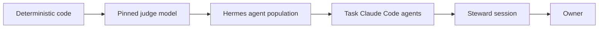

<h1 align="center">Mohammed Elsiddig</h1>

<b>AI Lead / AI Architect</b> · agentic systems in production · robotic intelligence · Dubai

I build agent systems that have to survive contact with real users. The model sits inside a deterministic core, every change is gated by tests and budgets, and every claim the system makes about itself is checked. I currently lead AI at **Debot Intelligent Automation**, Royal Furniture Group's AI and robotics venture, where I took the group's first production agentic-operations system from prototype to 1,400+ staff.

Most of my code is private: employer and client work. This page says what each system is, how it is built and what it solved; the code stays private. **Start with the three systems below.**

---

## Start here

### 🐉 Lernactal-OS: a personal AI operating system that evolves by adversarial iteration
`2026 – now` · `Python` `Hermes Agent` `Claude Code` `Docker` `Telegram` · solo

The name is *Lernaean hydra* + *fractal*. Every claim is a head; an adversary attacks it; a severed claim grows at least two successors; and the same loop runs at every scale, from a design note to the code to the agents themselves. It runs a population of open-source Hermes agents and headless Claude Code agents on one machine, behind one Telegram chat, doing real work: opportunity discovery and triage, a curated news desk, and a Bayesian forecasting ledger.

<b>Design notes</b>: ranks, measured variants, a frugal read path, and an evidence ladder

- **Ranks, not managers.** Six ranks run from deterministic code up to the owner, with peers equal within a rank. Each rank tunes the rank below through *recorded variants*: model × effort × context, each with a measure and a kill rule. Each variant is kept or retired against its own measure. No agent can edit its own prompt, model or metric.
- **Escalation ladder.** Every "look again later" job climbs code → judge model → agent → frontier agent → human. Context shrinks on the way down and briefs get more refined on the way up, and each rank audits a sample of the rank below.
- **Frugal read path.** A hook refuses whole-file reads of large files and routes them to a cheap judge or a question-focused reader. Those return verbatim, line-referenced quotes, and a summary is never accepted as evidence for a patch. The route is controlled by one switch, with a kill rule.
- **Probabilities come from code, never from a model.** A model only grades one piece of evidence against one statement on a fixed, capped scale. Forecasts are registered before the outcome and scored afterwards, and the ledger is append-only.
- **Protected boundaries.** No candidate change can touch evaluators, sealed tests, the budget ledger or its own approval. Only the exact artifact that was evaluated, identified by hash, is ever promoted. Containers hold no byte that git doesn't, images are pinned by digest, and there are separate hot and sealed deploy lanes.
- **Budgets.** A usage ledger that holds no content is reconciled against provider-reported usage. An allowance guard halts every Claude Code session at 95% of a usage window, and an empty heartbeat makes no model call.
- **How a change lands.** Each change needs a live end-to-end test showing the fault before and gone after, plus a fresh reviewer told to refute the diff. Both go in the commit body.

**Scale so far:** ~790 commits in five weeks, 12 services, ~300 test files, 82 decision records, and an Obsidian graph that renders the system's own claim tree.

### 🛋️ Royal AI Assistant: production agentic operations on WhatsApp
`2026` · `TypeScript` `Node` `PostgreSQL` `AWS CDK` `OpenClaw → Hermes` · AI Lead, architect and main author

The group's first production enterprise agent, and not a chatbot. Customers and 1,400+ staff reach it as one WhatsApp contact in English, Arabic and Hindi. It answers from live ERP data and turns every unresolved need into a routed, tracked ticket. A consistent 3,500+ chat turns and 350–400 unique users a day.

<b>Design notes</b>: safety in the database, a behaviour battery, a pinned and patched agent framework

- **Topology.** A webhook gate verifies signatures, de-duplicates messages and stands the AI down while a human is replying on the same number. An agent gateway, a cost-logging LLM proxy with sticky failover, an event-driven paging and dispatch listener on Postgres `LISTEN/NOTIFY`, a report-PDF sidecar and a migration container sit behind it, all defined in AWS CDK.
- **Safety in the database, not the prompt.** Row-level security is forced and fails closed, so no session context means no rows. Every write goes through a definer function. The on-prem ERP is mirrored one way into a scoped Postgres replica (full load plus change data capture).
- **A behaviour battery gates every change:** 340+ scenarios across 16 behaviour dimensions that send real signed webhooks to staging and grade the reply, the SQL it ran and the rows it left. The battery refuses production three independent ways. Model swaps pass frozen-baseline and verbosity regression gates, whose rubric anchors were mined from customer-rated tickets.
- **Patching a pinned, vendored framework.** Fixes to the third-party agent framework are applied at exact-match patch points. The build fails if a patch point drifts, and each patch has a kill switch and a line in the boot log that proves it applied.
- **Containment.** Recipient gates, per-customer rate caps with a runaway latch, per-flow kill switches, egress allowlisting against exfiltration, and secrets only in a managed store.
- **Operations.** 300+ additive migrations, SHA-tagged staging → prod promotion, written post-mortems that become regression harnesses, and a ~5× cut in model spend, with frozen prompt prefixes and KV-cache hit rate tracked as a first-class metric.
- **Then a migration onto Hermes,** for native skill curation, memory consolidation and an SQLite session store. That opens the path to one assistant per staff member, connected as peers.

### 🌐 Growbal AI Core: agentic profiling for a B2B services marketplace
`2025` · `Python` `Django` `LangGraph` `pgvector` `vLLM` · main author (76% of commits)

The AI behind a Gulf marketplace for company formation, tax and visa providers. Crawlers find providers and build structured profiles, an agent matches users to them, and a research-first onboarding flow asks providers only what it couldn't find. It cost under $0.10 per company profile with 95%+ structured-field coverage.

<b>Design notes</b>: line-indexed HTML slicing, hybrid ranking, research-driven onboarding

- **Line-indexed slicing.** Each line of page markdown is tagged `⟦L000⟧`. A small model returns only line *ranges*, and chunks are cut on stable newline boundaries, so extraction reads a fraction of the page. It later ran on a self-hosted, PEFT-fine-tuned open-weight model served with vLLM. The failure cases (empty or malformed slices) were studied in hypothesis notebooks and fixed with schema-injected function calling plus a rule-based fallback.
- **Retrieval.** Postgres + pgvector embeddings, ranked by vector similarity with a capped tag-match boost. A LangGraph *search → adjudicate → summarise* agent streams its answer into the chat front end.
- **Onboarding research orchestrator.** It researches the provider's industry on the web first, then adds or removes items from the onboarding checklist, so a provider confirms facts instead of typing them.
- **Platform.** Django backend, FastAPI + Gradio chat with server-side sessions and SSO, AWS deployment, CI/CD across microservices, and CloudWatch with agent-execution telemetry.

---

## Also built

| | |
|---|---|
| **Stock-Health Agent** · TypeScript, AWS CDK | Inventory advisor where the LLM only *calls* a deterministic engine for aging, velocity, cover and transfer-first balancing, plus a bounded research sub-agent. Confidence is weighted by which data is present, and the missing data is listed. Runs in an egress-locked runtime: proxy allowlist, firewall rules, exec allowlist, secrets only in SSM, and a daily LLM-cost alarm. |
| **Budget Analyst Agent** · LangGraph, DSPy, MCP, Next.js | Text-to-SQL over an event-budgeting platform. The model first sees a ~300-token schema summary, then loads only the domains it picks. Every query passes a parser-level read-only validator. The DSPy modules are compiled with a calibration metric, and NDJSON events stream to an AI SDK chat UI. It caught and flagged its own implausible 96.6% margin. |
| **LLM Robot Cell** · ROS2, FastAPI | An LLM "brain" plans pick-and-place; a deterministic "nervous system" checks speed and workspace bounds. A rejected plan goes back to the model with the reason and passes on the second attempt. Custom ROS2 interfaces, a state-machine orchestrator, four model back ends plus an offline stub, with per-call token and cost logging. |
| **Robotics AI Bench** · Docker, ZeroMQ, YOLO11, MediaPipe | Phase 0 of a robotic-assembly program. GPU pose and hand workers share one message envelope and publish heartbeats, with latest-frame-wins live video and MQTT → InfluxDB → Grafana telemetry. A vision-language-action slot refuses to start unless it is held advisory, and it can never reach the drive. |
| **Video Engagement Model** · Transformers | SigLIP2 frame embeddings fed into a pretrained DeiT encoder through a custom embedding-input layer and fused with text embeddings. Trained against an engineered engagement target: weighted view, like and comment ratios, Box-Cox de-skewed. |
| **Hybrid RAG + SQL Agent** · LangGraph, DSPy, Ollama | Routes each question to documents, SQL or both on a local 3.8B model. Typed repair loops (SQL error, invalid output, invalid citation) and chunk-level citations, with results reported honestly. |

Earlier: CNNs for harmful-algal-bloom detection (satellite, drone and microscopy data, DVC + MLflow) · computer vision deployed at three secured sites · a fintech transaction-enrichment engine and its logo standardiser · GCN-LSTM spatio-temporal forecasting · a ViT adapter for BirdCLEF audio.

---

## Track record

<!-- TRACK:START -->
| Repositories | Owned | Contributed to | Private | Active since | Last push |
|:-:|:-:|:-:|:-:|:-:|:-:|
| **25** | 23 | 2 | 25 | 2021 | 2026-10 |

Languages by repository: `Python` 10 · `Jupyter Notebook` 7 · `TypeScript` 3 · `JavaScript` 2 · `Shell` 1 · `Vue` 1

| Project | What it is | Stack | Period |
|---|---|---|---|
| **Lernactal-OS** 🔒 | Self-improving personal AI operating system: a ranked population of agents under measured, adversarially reviewed change | Python · Hermes Agent · Claude Code · Docker | 2026-09 → 2026-10 |
| **Royal AI Assistant** 🔒 | Production WhatsApp agentic-operations system for a 1,400-staff UAE retail group | TypeScript · PostgreSQL · AWS · OpenClaw | 2026-03 → 2026-09 |
| **Robotics AI Bench** 🔒 | Phase-0 perception bench for an industrial arm: GPU pose workers over ZeroMQ, telemetry, AI kept advisory | Python · Docker · YOLO11 · MediaPipe | 2026-04 |
| **Stock-Health Agent** 🔒 | Inventory advisor: LLM drives a deterministic stock engine and a bounded research sub-agent inside an egress-locked runtime | TypeScript · OpenClaw · AWS CDK | 2026-04 |
| **LLM Robot Cell** 🔒 | ROS2 cell where LLM motion plans pass a deterministic safety gate; rejections feed back into replanning | Python · ROS2 · FastAPI | 2026-02 |
| **Budget Analyst Agent** 🔒 | Text-to-SQL analyst: token-budgeted schema loading, read-only SQL validation, DSPy-compiled modules, calibrated confidence | Python · LangGraph · DSPy · MCP | 2026-01 → 2026-02 |
| **Budget Analyst UI** 🔒 | Streaming chat front end for the budget analyst: tool-call events over the Vercel AI SDK | TypeScript · Next.js · AI SDK | 2026-02 |
| **Growbal AI Core** 🔒 | Agentic crawler, hybrid vector search and onboarding research agent for a B2B services marketplace | Python · Django · LangGraph · pgvector | 2025-06 → 2025-10 |
| **Hybrid RAG + SQL Agent** 🔒 | Routes questions to documents, SQL or both on a local 3.8B model, with typed repair loops and citations | Python · LangGraph · DSPy · Ollama | 2025-09 |
| **Video Engagement Model** 🔒 | Multimodal engagement predictor: SigLIP2 frame embeddings through a DeiT encoder, fused with text | PyTorch · Keras · Transformers | 2025-04 |
| **Research Digest Agent** 🔒 | Scheduled search → relevance filter → summariser–reviewer critique loop → daily e-mail digest | Python · LangGraph | 2025-03 |
| **Speaking Coach** 🔒 | Local reasoning-model coach with a staged assessment dialogue and an embedding-quantised response cache | Python · Ollama · Gradio | 2025-03 |
| **BirdCLEF 2024** 🔒 | Audio frames (MFCC + RMS) reshaped by convolution into a pretrained ViT's input space | TensorFlow · Keras | 2024-06 |
| **Harmful Algae Detection** 🔒 | CNN proof of concept on underwater microscopy for a harmful-algal-bloom early-warning system | TensorFlow · DVC | 2024-01 |
| **Logo Standardizer** 🔒 | OpenCV pipeline that finds a logo and its background and normalises crop, centring and mask | Python · OpenCV | 2023-04 |
| **Graph Traffic Forecast** 🔒 | GCN-LSTM spatio-temporal forecasting on a road-sensor graph (MASE 0.69 vs naive) | TensorFlow · StellarGraph | 2021-10 |

🔒 private: name, description and dates shown; code is not. 9 further repositories (client work, research notebooks, experiments) are counted above but not named. Generated from repository metadata by <code>scripts/track-record.sh</code>.
<!-- TRACK:END -->

---

## How I build

- **A model is a component, not the system.** Arithmetic, safety and probabilities live in code; the model judges, routes and writes.
- **Prove it live.** Every change shows the fault before and its absence after, on the real path, and a reviewer who did not write it tries to refute it.
- **Measure, then keep or kill.** Prompts, models and thresholds are variants with a metric and a kill rule, decided on figures.
- **Fail closed, contain by default.** Allowlisted egress, per-flow kill switches, budgets checked before the call.
- **Leave a trail.** Decision records, post-mortems and pinned versions, so the next engineer, human or agent, starts with the reasons.

<a href="https://www.linkedin.com/in/mohammed-elsiddig-aa3211193"><b>LinkedIn</b></a> · B.Eng. (Hons) Electrical & Electronic Engineering, University of Nottingham · Arabic & English

